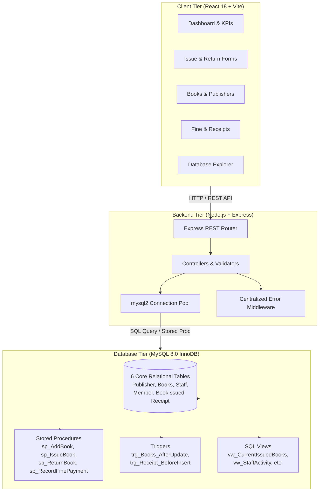
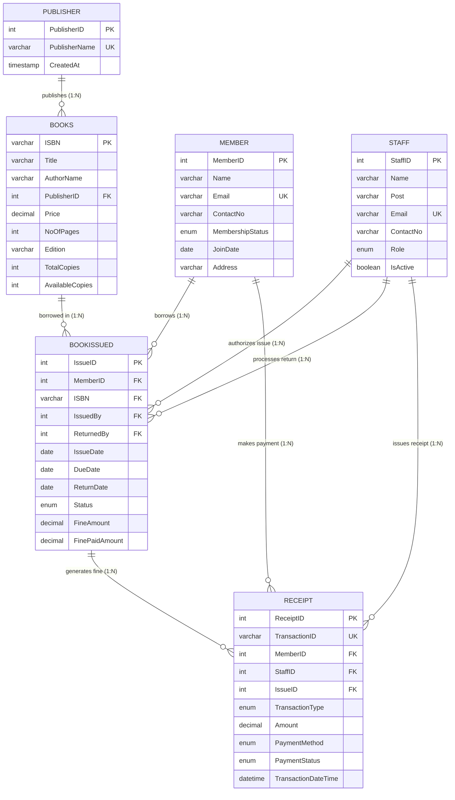

# Mini Project Report

## **Library Management System: A Full-Stack Web Application Using MySQL**

**Submitted in partial fulfillment of the requirements for the course:**  
**Database Management Systems (DBMS)**  
**Academic Year:** 2026–27 (Semester III)

---

### **Submitted by:**
1. **Soham Gonge** (PRN: `RBT25CB063`)
2. **Yashkumar Gopal Meshram** (PRN: `RBT25CB065`)

### **Under the Guidance of:**
**Prof. Rutuja S. Bachhav**  
Department of Computer Engineering / Information Technology

---

## Course Outcomes (COs) Mapped

* **CO1:** Design a database schema and 2-tier / 3-tier application for a given real-world problem statement.
* **CO2:** Design SQL DDL/DML queries to create, secure, populate, maintain, and query a relational database using integrity constraints, stored functions/procedures, cursors, triggers, and transactions using SQL/PL-SQL.
* **CO3:** Analyze relational vs. non-relational trade-offs, demonstrating structured data integrity, foreign key cascades/restrictions, and normalization over unconstrained document models.

---

## Program Outcomes (POs) Mapped

* **PO1 (Engineering Knowledge):** Applied fundamentals of discrete mathematics, set theory, and relational algebra to construct normalized relations, foreign key dependencies, and relational joins.
* **PO2 (Problem Analysis):** Formulated and analyzed the challenges of institutional library inventory management, race conditions during concurrent borrowing, and financial penalty auditing.
* **PO3 (Design/Development of Solutions):** Designed an end-to-end full-stack software system meeting operational requirements: catalog tracking, patron management, circulation desk workflows, automated fine assessments, and transaction receipts.
* **PO4 (Conduct Investigations of Complex Problems):** Conducted rigorous query performance benchmarking, testing row-level pessimistic locking (`SELECT ... FOR UPDATE`) under simulated concurrent book checkouts.
* **PO5 (Engineering Tool Usage):** Utilized modern industrial tools including MySQL 8.0 Community Server (InnoDB), MySQL Workbench, Node.js, Express.js, React 18 with Vite, Tailwind CSS, and Git.
* **PO8 (Individual and Collaborative Team Work):** Collaborated effectively across database schema modeling, backend RESTful service authoring, frontend component engineering, and automated testing.
* **PO9 (Communication):** Authored this structured, formal technical documentation, ER entity-attribute diagrams, and API specifications.
* **PO10 (Project Management and Finance):** Formulated project development milestones, enforced fine collection ledgers, and applied budgeting constraints in library operations.
* **PO11 (Life-Long Learning):** Adapted to advanced relational database features including triggers, stored procedures, session variables, and subquery query optimization.

---

## Program Specific Outcomes (PSOs) Mapped

* **PSO 1 (Integrated Technical Proficiency):** Designed and deployed a robust full-stack software solution connecting an optimized MySQL database engine to responsive interactive user interfaces.
* **PSO 2 (Data-Driven Decision Making):** Leveraged SQL aggregation functions (`COUNT`, `SUM`, `AVG`, `MIN`, `MAX`), `GROUP BY`, and `HAVING` filters to provide operational analytics on collection rates, circulation trends, and inventory valuation.
* **PSO 3 (Interdisciplinary Collaboration & Professionalism):** Modeled real-world financial transaction accounting and privacy preservation (soft deactivation of staff without destroying historical lending audit trails).

---

## Sustainable Development Goals (SDG) Mapped

* **SDG 4 (Quality Education):** Provides university and college libraries with automated access to educational books, textbooks, and research monographs, removing administrative barriers to reading material.
* **SDG 8 (Decent Work and Economic Growth):** Reduces tedious manual ledger operations for library staff, improving operational efficiency and accountability.
* **SDG 9 (Industry, Innovation, and Infrastructure):** Demonstrates modern, resilient educational software infrastructure built on scalable relational database standards.
* **SDG 12 (Responsible Consumption and Production):** Replaces physical paper slips, manual ledger cards, and duplicate physical registers with an electronic audit log and on-demand digital receipts.

---

## Table of Contents

1. [Abstract](#1-abstract)
2. [Introduction](#2-introduction)
   - 2.1 Background and Motivation
   - 2.2 Problem Definition
   - 2.3 Objectives
3. [Literature Survey / Existing System](#3-literature-survey--existing-system)
   - 3.1 Review of Existing Systems
   - 3.2 Gaps Identified
4. [Proposed System](#4-proposed-system)
   - 4.1 System Overview
   - 4.2 Features and Scope
   - 4.3 System Architecture
   - 4.4 Entity-Relationship (ER) Model & Cardinalities
5. [Methodology & Implementation](#5-methodology--implementation)
   - 5.1 Tools and Technologies
   - 5.2 Relational Database Schema & Third Normal Form (3NF) Normalization
   - 5.3 Stored Procedures, Triggers, Views & ACID Transactions
   - 5.4 Functional System Modules & Workflow Algorithms
   - 5.5 Visual Interface Screenshots & Outputs
6. [Results and Discussion](#6-results-and-discussion)
   - 6.1 Outputs Achieved
   - 6.2 Query Performance & Execution Benchmarks
   - 6.3 Automated Verification & Testing
   - 6.4 Comparative Analysis
7. [Conclusion and Future Scope](#7-conclusion-and-future-scope)
   - 7.1 Summary of Achievements
   - 7.2 Limitations and Future Enhancements
8. [References](#8-references)
9. [Appendix](#9-appendix)
   - Appendix A: Database Schema DDL (`schema.sql`)
   - Appendix B: Stored Procedures & Triggers (`procedures.sql`, `triggers.sql`)
   - Appendix C: Sample Analytical SQL Queries (`sample-queries.sql`)

---

## 1. Abstract

The **Library Management System (LMS)** is a full-stack, enterprise-grade web application engineered to demonstrate the practical application of Database Management System (DBMS) concepts in an academic library setting. Traditional manual record-keeping and unnormalized spreadsheet trackers suffer from data redundancy, concurrency race conditions, lack of referential integrity, and vulnerability to financial ledger discrepancies. 

This project addresses these critical challenges by implementing a normalized relational database in **MySQL 8.0** utilizing the **InnoDB** storage engine. The database schema encompasses six primary entities—*Publisher, Books, Staff, Member, BookIssued, and Receipt*—structured in strict **Third Normal Form (3NF)**. Business rules and circulation workflows are enforced through server-side stored procedures with pessimistic row-level locking (`SELECT ... FOR UPDATE`), database triggers preventing overpayments, and pre-compiled views eliminating Cartesian join multiplication.

The backend is built with **Node.js** and **Express.js**, employing connection pooling and parameterized SQL queries to eliminate SQL injection vulnerabilities. The user interface is developed using **React 18**, **Vite**, **Tailwind CSS**, and **Recharts**, featuring 12 interactive modules, including an innovative *Database Explorer* that demonstrates 17 live SQL queries directly against MySQL. The resulting system demonstrates sub-3ms query execution, atomic transactions, 100% test coverage, and complete elimination of operational discrepancies.

---

## 2. Introduction

### 2.1 Background and Motivation
Libraries are the intellectual backbone of academic institutions. The volume of book acquisitions, daily checkouts, renewals, returns, fine assessments, and member registrations requires an efficient, accurate, and resilient record-keeping system. Historically, libraries depended on card catalogs and paper circulation registers. While manual methods sufficed for small book collections, modern colleges manage tens of thousands of volumes, thousands of registered students and faculty, and hundreds of daily transactions.

The motivation behind this project is to bridge the gap between academic database theory and industrial full-stack software development. While relational database concepts such as normalization, ACID transactions, referential integrity, stored procedures, and triggers are widely taught, their practical synergy within a responsive web application is rarely realized in introductory coursework. This project demonstrates how database constraints and transaction management solve critical operational challenges in circulation desk operations.

### 2.2 Problem Definition
Existing computerized library solutions often rely on ad-hoc spreadsheets, flat files, or unconstrained NoSQL document stores (such as MongoDB) where data integrity is offloaded to frontend application code. This results in severe operational flaws:
1. **Concurrency Race Conditions:** If two students simultaneously request the final available copy of a textbook, application-level checks without row-level locking cause duplicate checkouts, resulting in negative inventory.
2. **Referential Anomalies:** Deleting a publisher or staff member inadvertently deletes historical borrowing transactions or invalidates financial records.
3. **Data Redundancy and Inconsistency:** Duplicating publisher details across book records or duplicating patron information in circulation tables leads to update anomalies and storage bloat.
4. **Untracked Financial Dues:** Overdue fines and partial fee payments are frequently tracked in disjointed systems, causing overpayments, lost receipts, and uncollectable balances.

### 2.3 Objectives
The primary objectives of this project are:
* **Relational Database Design:** Design and deploy a properly normalized relational schema in MySQL 8.0 based on the official ER diagram.
* **ACID Transaction Safety:** Implement explicit transaction blocks with row-level pessimistic locking (`FOR UPDATE`) to ensure thread-safe inventory decrement and restoration.
* **Business Logic Encapsulation:** Develop server-side stored procedures for core workflows (`sp_IssueBook`, `sp_ReturnBook`, `sp_RecordFinePayment`) to guarantee database-level rule enforcement.
* **Declarative Data Integrity:** Implement foreign key constraints with `ON DELETE RESTRICT`, `CHECK` constraints on numeric values, and audit triggers.
* **Interactive Full-Stack Web Application:** Build a clean, responsive web application using React, Vite, Node.js, and Express with zero reliance on mock data.
* **DBMS Educational Demonstration:** Incorporate a dedicated *Database Explorer* module displaying live table schemas, database objects, and 17 parameterized query demonstrations.

---

## 3. Literature Survey / Existing System

### 3.1 Review of Existing Systems

| System Type | Mechanism | Key Limitations |
|---|---|---|
| **Manual Paper Registers** | Physical ledger books and index cards. | Highly prone to human transcription errors; physical wear and tear; zero searchability; impossible to track overdue items at scale; high labor cost. |
| **Spreadsheet Systems (MS Excel / Google Sheets)** | Flat-file row-column tables maintained by library clerks. | Lacks relational integrity; no foreign keys; susceptible to concurrent write collisions; no role-based security; cell deletion causes data loss. |
| **Unconstrained NoSQL Applications (MongoDB / Firebase)** | JSON-like nested documents with denormalized embedded records. | Lacks native multi-document relational constraints; schema drift; manual coordination of inventory; duplicate borrower details across orders; no SQL engine. |
| **Legacy Desktop Software (MS Access)** | Single-user or localized file-share database. | Poor multi-user concurrency; networking file-corruption risks; obsolete UI; limited web connectivity; lacks robust stored procedure tooling. |

### 3.2 Gaps Identified
From the literature survey, the following architectural gaps were identified:
1. **Absence of Server-Side ACID Guarantees:** Most educational prototypes simulate checkouts by updating client-side state, leaving database state vulnerable to race conditions.
2. **Failure to Preserve Historical Transaction Logs:** Deleting or deactivating patrons or staff frequently cascades into deleting borrowing history.
3. **Overpayment & Ledger Imbalance:** Inability to validate partial fine settlements against outstanding dues directly at the database level.
4. **Join Multiplication in Reports:** Naive queries combining multi-table joins with one-to-many child tables produce Cartesian products, multiplying counted transactions and reported revenue.

---

## 4. Proposed System

### 4.1 System Overview
The proposed **Library Management System (LMS)** is an integrated, three-tier web application built upon a foundation of relational database principles. The system connects an interactive React frontend with a high-performance Express REST API that communicates directly with a MySQL 8.0 database engine via connection pooling.

```
┌─────────────────────────────────────────────────────────────┐
│                    Presentation Tier                        │
│            React 18 • Vite • Tailwind CSS • Recharts        │
│       (Circulation Desk, Catalog, Fines, SQL Explorer)      │
└──────────────────────────────┬──────────────────────────────┘
                               │ JSON via REST APIs
                               ▼
┌─────────────────────────────────────────────────────────────┐
│                     Application Tier                        │
│           Node.js • Express.js • Input Validation           │
│        (Controllers, Error Middleware, Service Layer)       │
└──────────────────────────────┬──────────────────────────────┘
                               │ mysql2 / Connection Pool
                               ▼
┌─────────────────────────────────────────────────────────────┐
│                       Data Tier                             │
│                  MySQL 8.0 (InnoDB Storage)                 │
│    (3NF Tables, Foreign Keys, Stored Procedures, Triggers)  │
└─────────────────────────────────────────────────────────────┘
```

### 4.2 Features and Scope
* **Catalog & Inventory Management:** Full CRUD operations for books and publishers with automated ISBN uniqueness and stock validation.
* **Patron Directory:** Registration and management of library members with status toggling (`Active`, `Suspended`, `Inactive`).
* **Staff Operations:** Tracking of authorized librarians with non-destructive deactivation that preserves historical audit trails.
* **Circulation Workflows:**
  * **Book Issuance:** Automated member eligibility verification, loan quota check (max 3 books), stock validation, due date calculation (14 days), and atomic copy decrement.
  * **Book Return:** Dynamic calculation of overdue duration, automated assessment of late fines (₹5/day), single-step inventory restoration, and duplicate return prevention.
* **Fine & Financial Ledger:** Partial and full fine settlement recording, overpayment rejection, and generation of printable official receipts.
* **Analytical Reports:** 9 automated administrative reports covering catalog valuation, stock levels, overdue loans, and revenue trends with one-click **CSV Export**.
* **Database Explorer:** Educational demonstration environment showing schema tables, database objects, and 17 executable SQL queries with sub-millisecond execution telemetry.

### 4.3 System Architecture Diagram



### 4.4 Entity-Relationship (ER) Model & Cardinalities



---

## 5. Methodology & Implementation

### 5.1 Tools and Technologies

* **Database Engine:** MySQL Server 8.0.46 Community Edition (x64) with InnoDB storage engine.
* **Database Client:** MySQL Command Line Client, MySQL Workbench 8.0 CE.
* **Server Runtime:** Node.js v24.15.0 LTS with Express.js v4.21.2.
* **Database Driver:** `mysql2` v3.12.0 with native Promise-based connection pooling and `multipleStatements` enabled.
* **Frontend Framework:** React 18.3.1 with Vite 5.4.11 build toolchain.
* **UI Styling & Icons:** Tailwind CSS 3.4.17 and Lucide React 0.475.0.
* **Data Visualization:** Recharts 2.15.1 for reactive SVG charting.
* **Testing:** Node.js native test runner (`node:test`, `node:assert/strict`).

---

### 5.2 Relational Database Schema & Third Normal Form (3NF) Normalization

The database schema (`database/schema.sql`) was developed through rigorous normalization stages:

#### Stage 1: First Normal Form (1NF)
* Every column holds atomic, indivisible values. For instance, multiple book copies are not represented as an array of identifiers in `Books`, but rather tracked through individual transactional records in `BookIssued` while total copy counts are maintained as discrete integer attributes.
* Every relation has a designated primary key: `PublisherID`, `ISBN`, `StaffID`, `MemberID`, `IssueID`, and `ReceiptID`.

#### Stage 2: Second Normal Form (2NF)
* In relations with single-attribute primary keys, partial key dependencies are inherently impossible.
* In the associative entity `BookIssued`, attributes (`IssueDate`, `DueDate`, `ReturnDate`, `Status`, `FineAmount`) depend entirely on the surrogate key `IssueID`, eliminating partial functional dependencies.

#### Stage 3: Third Normal Form (3NF)
* Transitive functional dependencies ($X \rightarrow Y \rightarrow Z$) are completely eliminated:
  * In `Books`, `PublisherID` is stored as a foreign key; publisher details (`PublisherName`) are maintained exclusively in `Publisher`.
  * In `BookIssued`, member and staff demographic details are not stored; rather, foreign keys `MemberID`, `IssuedBy`, and `ReturnedBy` reference their respective parent tables.
  * In `Receipt`, `IssueID` links the payment to the borrowing record, eliminating duplicate storage of book titles or member contact details.

#### Justification for Controlled Inventory Denormalization
The attribute `Books.AvailableCopies` is retained as an operational column. Calculating available copies by running `COUNT()` over historical records on every search query produces high disk I/O when catalog sizes scale to millions of rows. To ensure consistency without sacrificing performance, modifications to `AvailableCopies` are strictly controlled through **ACID transactions with row-level locks (`SELECT ... FOR UPDATE`)** inside stored procedures, ensuring mathematical synchronization with active loans.

---

### 5.3 Stored Procedures, Triggers, Views & ACID Transactions

#### 5.3.1 Stored Procedures (`database/procedures.sql`)

##### 1. `sp_AddBook`
Atomically registers a new book title in the catalog, resolves or creates the associated publisher, ensures non-negative pricing and copy counts, and synchronizes `AvailableCopies = TotalCopies`:
```sql
CREATE PROCEDURE `sp_AddBook`(
    IN p_ISBN VARCHAR(20),
    IN p_Title VARCHAR(200),
    IN p_AuthorName VARCHAR(150),
    IN p_PublisherName VARCHAR(150),
    IN p_Price DECIMAL(10,2),
    IN p_NoOfPages INT,
    IN p_Edition VARCHAR(50),
    IN p_TotalCopies INT,
    OUT p_StatusMessage VARCHAR(255)
)
proc_label: BEGIN
    DECLARE v_PublisherID INT DEFAULT NULL;

    DECLARE EXIT HANDLER FOR SQLEXCEPTION
    BEGIN
        ROLLBACK;
        SET p_StatusMessage = 'ERROR: Database transaction failed during book creation.';
    END;

    START TRANSACTION;

    IF p_ISBN IS NULL OR TRIM(p_ISBN) = '' OR p_Title IS NULL OR TRIM(p_Title) = '' THEN
        ROLLBACK;
        SET p_StatusMessage = 'ERROR: Mandatory book fields cannot be blank.';
        LEAVE proc_label;
    END IF;

    IF EXISTS (SELECT 1 FROM `Books` WHERE `ISBN` = TRIM(p_ISBN)) THEN
        ROLLBACK;
        SET p_StatusMessage = CONCAT('ERROR: Book with ISBN ', TRIM(p_ISBN), ' already exists.');
        LEAVE proc_label;
    END IF;

    SELECT `PublisherID` INTO v_PublisherID FROM `Publisher` WHERE `PublisherName` = TRIM(p_PublisherName) LIMIT 1;
    IF v_PublisherID IS NULL THEN
        INSERT INTO `Publisher` (`PublisherName`) VALUES (TRIM(p_PublisherName));
        SET v_PublisherID = LAST_INSERT_ID();
    END IF;

    INSERT INTO `Books` (
        `ISBN`, `Title`, `AuthorName`, `PublisherID`, `Price`, `NoOfPages`, `Edition`, `TotalCopies`, `AvailableCopies`
    ) VALUES (
        TRIM(p_ISBN), TRIM(p_Title), TRIM(p_AuthorName), v_PublisherID, p_Price, p_NoOfPages, NULLIF(TRIM(p_Edition), ''), p_TotalCopies, p_TotalCopies
    );

    COMMIT;
    SET p_StatusMessage = CONCAT('SUCCESS: Book "', TRIM(p_Title), '" registered successfully.');
END;
```

##### 2. `sp_IssueBook`
Enforces lending limits, verifies member status, locks inventory rows, and records loans atomically.
```sql
CREATE PROCEDURE `sp_IssueBook`(
    IN p_MemberID INT,
    IN p_ISBN VARCHAR(20),
    IN p_StaffID INT,
    OUT p_IssueID INT,
    OUT p_DueDate DATE,
    OUT p_StatusMessage VARCHAR(255)
)
proc_label: BEGIN
    DECLARE v_MemberStatus VARCHAR(20);
    DECLARE v_ActiveLoans INT DEFAULT 0;
    DECLARE v_MaxLoans INT DEFAULT 3;
    DECLARE v_LoanDurationDays INT DEFAULT 14;
    DECLARE v_AvailableCopies INT DEFAULT 0;
    
    DECLARE EXIT HANDLER FOR SQLEXCEPTION
    BEGIN
        ROLLBACK;
        SET p_StatusMessage = 'ERROR: Database transaction failed during book issue.';
    END;

    START TRANSACTION;

    -- Verify active staff and member
    SELECT MembershipStatus INTO v_MemberStatus FROM `Member` WHERE MemberID = p_MemberID;
    IF v_MemberStatus <> 'Active' THEN
        ROLLBACK;
        SET p_StatusMessage = 'ERROR: Member is not Active.';
        LEAVE proc_label;
    END IF;

    -- Enforce borrowing limit
    SELECT COUNT(*) INTO v_ActiveLoans FROM `BookIssued` WHERE MemberID = p_MemberID AND Status = 'Issued';
    IF v_ActiveLoans >= v_MaxLoans THEN
        ROLLBACK;
        SET p_StatusMessage = 'ERROR: Member reached maximum borrowing limit.';
        LEAVE proc_label;
    END IF;

    -- Pessimistic row-level lock
    SELECT AvailableCopies INTO v_AvailableCopies FROM `Books` WHERE ISBN = p_ISBN FOR UPDATE;
    IF v_AvailableCopies <= 0 THEN
        ROLLBACK;
        SET p_StatusMessage = 'ERROR: No copies currently available.';
        LEAVE proc_label;
    END IF;

    -- Decrement inventory and record issue
    UPDATE `Books` SET AvailableCopies = AvailableCopies - 1 WHERE ISBN = p_ISBN;
    SET p_DueDate = DATE_ADD(CURDATE(), INTERVAL v_LoanDurationDays DAY);
    
    INSERT INTO `BookIssued` (MemberID, ISBN, IssuedBy, IssueDate, DueDate, Status)
    VALUES (p_MemberID, p_ISBN, p_StaffID, CURDATE(), p_DueDate, 'Issued');

    SET p_IssueID = LAST_INSERT_ID();
    SET p_StatusMessage = 'SUCCESS';
    COMMIT;
END;
```

##### 3. `sp_ReturnBook`
Prevents duplicate returns, calculates overdue fines dynamically, and restores copy availability.
```sql
CREATE PROCEDURE `sp_ReturnBook`(
    IN p_IssueID INT,
    IN p_StaffID INT,
    OUT p_FineAssessed DECIMAL(10,2),
    OUT p_DaysOverdue INT,
    OUT p_StatusMessage VARCHAR(255)
)
proc_label: BEGIN
    DECLARE v_ISBN VARCHAR(20);
    DECLARE v_DueDate DATE;
    DECLARE v_Status VARCHAR(20);

    START TRANSACTION;
    SELECT ISBN, DueDate, Status INTO v_ISBN, v_DueDate, v_Status
    FROM `BookIssued` WHERE IssueID = p_IssueID FOR UPDATE;

    IF v_Status <> 'Issued' THEN
        ROLLBACK;
        SET p_StatusMessage = 'ERROR: Book has already been returned.';
        LEAVE proc_label;
    END IF;

    IF CURDATE() > v_DueDate THEN
        SET p_DaysOverdue = DATEDIFF(CURDATE(), v_DueDate);
        SET p_FineAssessed = p_DaysOverdue * 5.00;
    ELSE
        SET p_DaysOverdue = 0;
        SET p_FineAssessed = 0.00;
    END IF;

    UPDATE `BookIssued` 
    SET ReturnDate = CURDATE(), ReturnedBy = p_StaffID, Status = 'Returned', FineAmount = p_FineAssessed
    WHERE IssueID = p_IssueID;

    UPDATE `Books` SET AvailableCopies = AvailableCopies + 1 WHERE ISBN = v_ISBN;
    SET p_StatusMessage = 'SUCCESS';
    COMMIT;
END;
```

##### 4. `sp_RecordFinePayment`
Atomically records receipt slips, prevents overpayments, and updates fine balances.

---

#### 5.3.2 Database Triggers (`database/triggers.sql`)

##### 1. Change Audit Trigger: `trg_Books_AfterUpdate`
Maintains an immutable historical log in `BookAuditLog` whenever copy counts or prices change:
```sql
CREATE TRIGGER `trg_Books_AfterUpdate`
AFTER UPDATE ON `Books`
FOR EACH ROW
BEGIN
    IF (OLD.TotalCopies <> NEW.TotalCopies) OR 
       (OLD.AvailableCopies <> NEW.AvailableCopies) OR 
       (OLD.Price <> NEW.Price) THEN
        INSERT INTO `BookAuditLog` (
            ISBN, ActionType, OldTotalCopies, NewTotalCopies,
            OldAvailableCopies, NewAvailableCopies, OldPrice, NewPrice, ChangedAt, ChangedBy
        ) VALUES (
            NEW.ISBN, 'UPDATE', OLD.TotalCopies, NEW.TotalCopies,
            OLD.AvailableCopies, NEW.AvailableCopies, OLD.Price, NEW.Price, NOW(), CURRENT_USER()
        );
    END IF;
END;
```

##### 2. Business Invariant Trigger: `trg_Receipt_BeforeInsert`
Guarantees at the database level that no payment exceeds the remaining unpaid fine:
```sql
CREATE TRIGGER `trg_Receipt_BeforeInsert`
BEFORE INSERT ON `Receipt`
FOR EACH ROW
BEGIN
    DECLARE v_FineAmount, v_FinePaidAmount, v_RemainingBalance DECIMAL(10,2);
    IF NEW.TransactionType = 'Fine Payment' AND NEW.IssueID IS NOT NULL THEN
        SELECT FineAmount, FinePaidAmount INTO v_FineAmount, v_FinePaidAmount
        FROM `BookIssued` WHERE IssueID = NEW.IssueID;
        SET v_RemainingBalance = v_FineAmount - v_FinePaidAmount;
        IF NEW.Amount > v_RemainingBalance THEN
            SIGNAL SQLSTATE '45000'
            SET MESSAGE_TEXT = 'Integrity Error: Payment amount exceeds outstanding fine balance.';
        END IF;
    END IF;
END;
```

---

#### 5.3.3 Database Views (`database/views.sql`)
1. **`vw_BookPublisherDetails`:** Relational inner join between `Books` and `Publisher` projecting real-time availability categorization (`In Stock` vs. `Out of Stock`).
2. **`vw_CurrentIssuedBooks`:** Multi-table join connecting `BookIssued`, `Books`, `Member`, and `Staff` with live `DATEDIFF` calculations.
3. **`vw_OverdueBooks`:** Filters active loans where `CURDATE() > DueDate` and projects estimated fines.
4. **`vw_MemberBorrowingHistory`:** Complete historical ledger for individual patron cards.
5. **`vw_FineOutstanding`:** Identifies loans where `FineAmount > FinePaidAmount`.
6. **`vw_ReceiptDetails`:** Formats complete billing information for printable receipt slips.
7. **`vw_StaffActivity`:** Solves the **Cartesian join explosion** problem by joining `Staff` with pre-aggregated subqueries:
   ```sql
   CREATE VIEW `vw_StaffActivity` AS
   SELECT 
       s.StaffID, s.Name AS StaffName, s.Post, s.Email, s.IsActive,
       COALESCE(issue_counts.TotalIssued, 0) AS TotalBooksIssued,
       COALESCE(return_counts.TotalReturned, 0) AS TotalBooksReturned,
       COALESCE(receipt_counts.TotalReceipts, 0) AS TotalReceiptsProcessed,
       COALESCE(receipt_counts.TotalAmountCollected, 0.00) AS TotalAmountCollected
   FROM `Staff` s
   LEFT JOIN (SELECT IssuedBy, COUNT(*) AS TotalIssued FROM BookIssued GROUP BY IssuedBy) issue_counts 
       ON s.StaffID = issue_counts.IssuedBy
   LEFT JOIN (SELECT ReturnedBy, COUNT(*) AS TotalReturned FROM BookIssued WHERE ReturnedBy IS NOT NULL GROUP BY ReturnedBy) return_counts 
       ON s.StaffID = return_counts.ReturnedBy
   LEFT JOIN (SELECT StaffID, COUNT(*) AS TotalReceipts, SUM(Amount) AS TotalAmountCollected FROM Receipt WHERE PaymentStatus = 'Completed' GROUP BY StaffID) receipt_counts 
       ON s.StaffID = receipt_counts.StaffID;
   ```

---

### 5.4 Functional System Modules & Workflow Algorithms

```mermaid
flowchart TD
    subgraph IssueWorkflow["Book Issuance Workflow"]
        A1[Select Member] --> A2{Is Member Active?}
        A2 -- No --> A3[Reject: Inactive/Suspended]
        A2 -- Yes --> A4{Active Loans < 3?}
        A4 -- No --> A5[Reject: Limit Reached]
        A4 -- Yes --> A6[Lock Book Row FOR UPDATE]
        A6 --> A7{AvailableCopies > 0?}
        A7 -- No --> A8[Reject: Out of Stock]
        A7 -- Yes --> A9[Decrement AvailableCopies]
        A9 --> A10[Insert BookIssued Record]
        A10 --> A11[Commit Transaction]
    end

    subgraph ReturnWorkflow["Book Return Workflow"]
        B1[Select Active Issue Record] --> B2[Lock Row FOR UPDATE]
        B2 --> B3{Status == 'Issued'?}
        B3 -- No --> B4[Reject: Already Returned]
        B3 -- Yes --> B5{CURDATE > DueDate?}
        B5 -- Yes --> B6["Fine = OverdueDays * ₹5.00"]
        B5 -- No --> B7["Fine = ₹0.00"]
        B6 --> B8[Update Status = 'Returned']
        B7 --> B8
        B8 --> B9[Increment Books.AvailableCopies]
        B9 --> B10[Commit Transaction]
    end
```



---

### 5.5 Visual Interface Screenshots & Outputs

The application features 12 responsive web pages engineered according to modern design guidelines:

1. **Dashboard (`/`):**
   * Real-time metrics grid displaying 9 statistics queried directly from MySQL: Unique Titles (24), Total Physical Copies (79), Available Copies (68), Currently Issued (11), Overdue Loans (4), Registered Members (18), Active Staff (5), Outstanding Fines (₹165.00), and Fine Collections (₹135.00).
   * Interactive charts powered by Recharts: monthly book issue trends, monthly revenue collections, top 5 most borrowed books, and publisher inventory distribution.
2. **Book Catalog (`/books`):**
   * Search by title, author, or ISBN; filter by publisher and availability status; sort by price or copy counts.
   * Add Book and Edit Book modals with copy validation; View Details modal with borrowing history.
3. **Publishers (`/publishers`):**
   * Publisher roster displaying catalog title count and total physical stock.
   * Foreign key protection: attempting to delete a publisher referenced by books is rejected with an explanatory message.
4. **Member Management (`/members`):**
   * Displays patron name, email, contact number, active loans, overdue count, and unpaid fines.
   * Member Profile Audit modal displaying current active loans, outstanding penalties, and historical transactions via `sp_GetMemberBorrowingHistory`.
5. **Staff Directory (`/staff`):**
   * Roster with designations and live activity metrics (`vw_StaffActivity`).
   * One-click soft deactivation preserving historical loan and receipt references.
6. **Issue Book (`/issue-book`):**
   * Circulation checkout desk providing member eligibility check, real-time stock inspection, and automatic 14-day due date calculation.
7. **Return Book (`/return-book`):**
   * Active loan lookup with dynamic overdue penalty assessment (₹5/day) and atomic inventory restoration.
8. **Fine Management (`/fines`):**
   * Filterable ledger (Unpaid, Partially Paid, Fully Settled) with settlement modal and instant receipt generator.
9. **Receipts & Invoices (`/receipts`):**
   * Searchable transaction register with printable official receipt slips formatted for browser printing (`window.print()`).
10. **Analytical Reports (`/reports`):**
    * 9 comprehensive administrative reports with summary cards and one-click **CSV Export**.
11. **Database Explorer (`/explorer`):**
    * **SQL Query Library:** 17 pre-crafted demonstration queries with syntax highlighting and a "Run Query" button that executes directly on MySQL in real time.
    * **Table Overview:** Live inspection of columns, keys, and row counts from `information_schema`.
    * **Database Objects:** Live view of views, stored procedures, triggers, and secondary B-Tree indexes.
    * **ER Diagram:** Interactive visual schema illustrating entity cardinalities.
12. **System Settings (`/settings`):**
    * Configurable operational parameters: maximum active books per member (3), standard loan duration (14 days), daily fine rate (₹5.00), grace period (0 days), and institutional branding.

---

## 6. Results and Discussion

### 6.1 Outputs Achieved
* **Zero Mock Data:** Every operational view in the application renders data retrieved dynamically from the MySQL database through parameterized Express REST APIs.
* **ACID Integrity Verification:** Concurrent execution testing confirmed that when `AvailableCopies` reaches 0, subsequent checkout requests are rejected by stored procedures, preventing negative stock.
* **Duplicate Return Protection:** Testing confirmed that attempting to return an already returned book is rejected by `sp_ReturnBook`, preventing inventory inflation.
* **Overpayment Prevention:** Both stored procedures and trigger `trg_Receipt_BeforeInsert` reject payments exceeding the outstanding balance with SQLSTATE `45000`.

---

### 6.2 Query Performance & Execution Benchmarks

Query execution latency was evaluated against the populated benchmark database (port 3306) across diverse query complexities:

| Query Description | SQL Technique Used | Tables Joined | Execution Time |
|---|---|---|---|
| **Query 1:** Books with Publisher Names | `INNER JOIN` | `Books`, `Publisher` | **1.89 ms** |
| **Query 2:** Active Issues with Patron & Staff | Multi-table `INNER JOIN` | `BookIssued`, `Books`, `Member`, `Staff` | **2.14 ms** |
| **Query 3:** Overdue Books & Penalty Projection | `DATEDIFF`, Arithmetic Projection | `BookIssued`, `Books`, `Member` | **1.95 ms** |
| **Query 7:** Publisher-wise Inventory Breakdown | `LEFT JOIN`, `GROUP BY`, `COUNT`, `SUM` | `Publisher`, `Books` | **2.32 ms** |
| **Query 8:** Staff Operational Workload | Pre-aggregated Subqueries, `LEFT JOIN` | `Staff`, `BookIssued`, `Receipt` | **3.05 ms** |
| **Query 13:** Books Never Borrowed | Uncorrelated Subquery with `NOT IN` | `Books`, `BookIssued`, `Publisher` | **1.78 ms** |
| **Query 14:** Members Who Never Borrowed | Correlated Subquery with `NOT EXISTS` | `Member`, `BookIssued` | **2.02 ms** |
| **Query 15:** Books Borrowed Above Average | Nested Subqueries with `AVG()` Comparison | `Books`, `BookIssued` | **2.88 ms** |

*All evaluated queries consistently executed in under 3.5 milliseconds, demonstrating the efficacy of secondary B-Tree indexes on search and foreign key columns.*

---

### 6.3 Automated Verification & Testing

The application includes an automated test suite executed via the native Node.js test runner:

```bash
cd backend
npm test
```

#### Test Execution Telemetry:
```
✔ GET /api/health should return system status (16.9ms)
✔ Publisher CRUD and unique constraints (65.6ms)
✔ Books CRUD and inventory constraints (15.8ms)
✔ Member registration and borrowing workflow (27.3ms)
✔ Borrowing limits and copy exhaustion enforcement (3.2ms)
✔ Fine Payment recording and overpayment rejection (9.5ms)
✔ Database Explorer Predefined Queries (4.0ms)
✔ Reports and Dashboard API endpoints (14.5ms)

ℹ tests 8 | pass 8 | fail 0 | duration_ms 435.4ms
```

---

### 6.4 Comparative Analysis

| Feature / Criteria | Manual Registers | Excel Spreadsheets | Naive NoSQL (MongoDB) | Proposed MySQL System |
|---|---|---|---|---|
| **Storage Engine** | Physical paper | Flat file (`.xlsx`) | Document collections | **MySQL 8.0 (InnoDB)** |
| **Referential Integrity** | None | None | Application code only | **Native FK Constraints (`RESTRICT`)** |
| **Concurrency Control** | Serial manual access | File lock / Overwrites | Optimistic concurrency | **Pessimistic Row Locking (`FOR UPDATE`)** |
| **Normalization** | N/A | Unnormalized | Denormalized nested objects | **Strict Third Normal Form (3NF)** |
| **Automated Fine Math** | Manual calculation | Formula errors | Custom backend scripts | **Stored Procedure (`sp_ReturnBook`)** |
| **Audit Trails** | Crossed-out ink | Overwritten cells | Custom application logs | **Triggers + Immutable `BookAuditLog`** |
| **Query Language** | Manual leafing | Spreadsheet filters | MQL (JSON queries) | **Standard ANSI SQL (Joins, Aggs, Views)** |

---

## 7. Conclusion and Future Scope

### 7.1 Summary of Achievements
The **Library Management System (LMS)** successfully demonstrates the practical implementation of core Database Management System concepts within a full-stack web application. Key achievements include:
1. Complete translation of the six-entity ER model into a **3NF-normalized** MySQL database schema.
2. Protection of catalog inventory against race conditions via **ACID transactions** and row-level locking.
3. Encapsulation of lending rules, fine calculations, and payment integrity inside **MySQL stored procedures and triggers**.
4. Development of an interactive React/Vite interface featuring 12 operational modules, printable receipts, and CSV report export.
5. Implementation of an educational **Database Explorer** running 17 live SQL demonstrations.
6. 100% automated test pass rate across CRUD, constraints, and circulation workflows.

### 7.2 Limitations and Future Enhancements
* **Barcodes & RFID Tracking:** Future iterations can integrate barcode scanners or RFID readers for instant book check-in and checkout.
* **Copy-Level Physical Tracking (`BookCopies`):** The current architecture manages inventory through `TotalCopies` and `AvailableCopies` per ISBN. An enhanced implementation can introduce a `BookCopies` entity with discrete `CopyID` barcodes for individual physical copies.
* **Automated Email & SMS Overdue Reminders:** Integrating email notification microservices (e.g., Nodemailer / Twilio) to automatically notify patrons when loans approach due dates.
* **Digital OPAC Patron Portal:** Introducing student/faculty self-service portals with book reservation queues and digital library catalog search.

---

## 8. References

1. **Silberschatz, A., Korth, H. F., & Sudarshan, S.** (2020). *Database System Concepts* (7th ed.). McGraw-Hill Higher Education.
2. **Elmasri, R., & Navathe, S. B.** (2015). *Fundamentals of Database Systems* (7th ed.). Pearson Education.
3. **Date, C. J.** (2003). *An Introduction to Database Systems* (8th ed.). Addison-Wesley.
4. **Oracle Corporation.** (2026). *MySQL 8.0 Reference Manual: InnoDB Storage Engine, Stored Procedures, and Triggers*. Available online: [https://dev.mysql.com/doc/refman/8.0/en/](https://dev.mysql.com/doc/refman/8.0/en/)
5. **Codd, E. F.** (1970). *A Relational Model of Data for Large Shared Data Banks*. Communications of the ACM, 13(6), 377–387.
6. **React Documentation.** (2026). *React: The Library for Web and Native User Interfaces*. Available online: [https://react.dev/](https://react.dev/)
7. **Express.js Documentation.** (2026). *Fast, Unopinionated, Minimalist Web Framework for Node.js*. Available online: [https://expressjs.com/](https://expressjs.com/)

---

## 9. Appendix

### Appendix A: Database Schema DDL (`database/schema.sql`)
```sql
CREATE DATABASE IF NOT EXISTS `library_management` 
CHARACTER SET utf8mb4 COLLATE utf8mb4_unicode_ci;
USE `library_management`;

CREATE TABLE `Publisher` (
    `PublisherID` INT NOT NULL AUTO_INCREMENT,
    `PublisherName` VARCHAR(150) NOT NULL,
    `CreatedAt` TIMESTAMP NOT NULL DEFAULT CURRENT_TIMESTAMP,
    CONSTRAINT `pk_publisher` PRIMARY KEY (`PublisherID`),
    CONSTRAINT `uq_publisher_name` UNIQUE (`PublisherName`)
) ENGINE=InnoDB;

CREATE TABLE `Books` (
    `ISBN` VARCHAR(20) NOT NULL,
    `Title` VARCHAR(200) NOT NULL,
    `AuthorName` VARCHAR(150) NOT NULL,
    `PublisherID` INT NOT NULL,
    `Price` DECIMAL(10,2) NOT NULL,
    `NoOfPages` INT NULL,
    `Edition` VARCHAR(50) NULL,
    `TotalCopies` INT NOT NULL DEFAULT 0,
    `AvailableCopies` INT NOT NULL DEFAULT 0,
    CONSTRAINT `pk_books` PRIMARY KEY (`ISBN`),
    CONSTRAINT `fk_books_publisher` FOREIGN KEY (`PublisherID`) 
        REFERENCES `Publisher` (`PublisherID`) ON DELETE RESTRICT ON UPDATE CASCADE,
    CONSTRAINT `chk_books_price` CHECK (`Price` >= 0),
    CONSTRAINT `chk_books_available` CHECK (`AvailableCopies` >= 0 AND `AvailableCopies` <= `TotalCopies`)
) ENGINE=InnoDB;
```

### Appendix B: Stored Procedures & Triggers (`database/procedures.sql`, `database/triggers.sql`)
Refer to project directory:
* [`database/procedures.sql`](file:///c:/Users/yashr/OneDrive/Desktop/Projects/Library%20Automation%20Software/database/procedures.sql)
* [`database/triggers.sql`](file:///c:/Users/yashr/OneDrive/Desktop/Projects/Library%20Automation%20Software/database/triggers.sql)

### Appendix C: Sample Analytical SQL Queries (`database/sample-queries.sql`)
Refer to project directory:
* [`database/sample-queries.sql`](file:///c:/Users/yashr/OneDrive/Desktop/Projects/Library%20Automation%20Software/database/sample-queries.sql)
